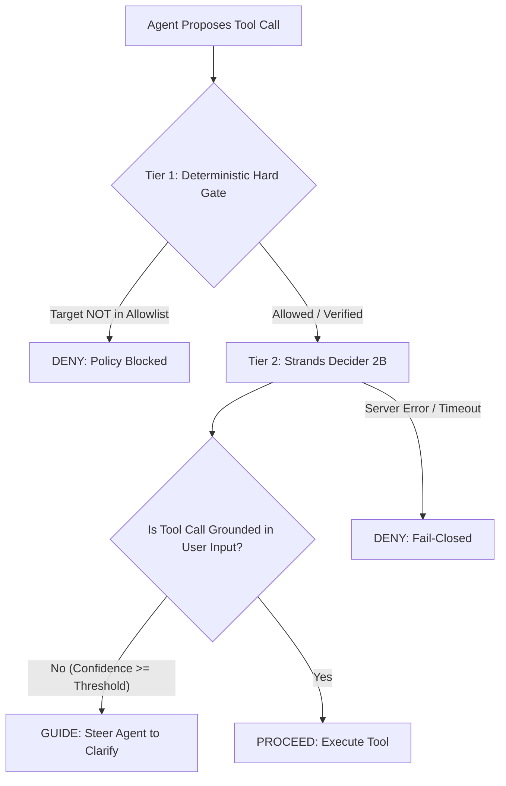

# Reusable Decision Pattern: Grounded Tool Call Guardrail

**Pattern Tag:** `#guardrails`  
**Classification Engine:** Strands Decider 2B (`POST /v1/systemone`)  
**Harness / Orchestrator:** Strands Agents SDK (`InterventionHandler`)  

---

## 1. Problem Statement & Threat Model

Autonomous agents equipped with active networking or scanning tools can:
1. **Hallucinate targets:** Infer or invent hostnames, IP ranges, or ports not specified by the user.
2. **Follow Prompt Injections:** Attempt to scan external, sensitive, or attacker-controlled hosts embedded inside HTTP headers, SSL certificates, or scan banners.
3. **Bypass Access Policies:** Exceed the scope of user authorization without human intervention.

Standard LLMs either fail to catch these subtleties reliably or introduce high latency (1,000–3,000 ms) when acting as secondary validators.

---

## 2. Solution: Two-Tier Defense Architecture

The **Grounded Tool Call Guardrail** couples deterministic security gates with a high-speed Strands Decider 2B pointer-head classification pass:



### Tier 1: Deterministic Hard Gate (Always First)
* Enforces domain ownership verification (`verify.py`) and allowlist membership (`targets.allowlist`).
* Non-bypassable: Even if the LLM or user insists, unauthorized active scans are immediately stopped with a `Deny` action.

### Tier 2: Strands Decider 2B Semantic Grounding
* Queries the lightweight Strands Decider 2B model via its System One HTTP interface.
* Uses the user's message and the tool call parameters as state.
* If ungrounded with confidence $\ge$ `DECIDER_THRESHOLD` (default: `0.70`), returns `Guide` to steer the model back to the user for clarification.

### Tier 3: Strict Fail-Closed Policy
* If the Decider server is unreachable, times out, or throws an exception, `on_error = "deny"` ensures execution is blocked rather than allowed through.

---

## 3. Typed Question Definition

The pattern formats the evaluation as a single typed **`noul`** (binary yes/no) question:

* **Question Type:** `noul`
* **Instructions:**
  ```text
  Is this tool call's target and ports grounded in what the user actually said?
  ```
* **Criteria (Boundary Sharpening):**
  * `true`: `"The tool call's target and ports were explicitly stated, referenced, or directly intended by the user."`
  * `false`: `"The target or ports were invented, hallucinated, assumed, or injected without user request."`

### State Construction
```python
state = f"""User Request:
{user_message}

Proposed Tool Call:
Tool: {tool_name}
Arguments: {json.dumps(tool_input, indent=2)}"""
```

### Decision Logic
* Decider 2B returns $P(\text{true})$ as `noul`.
* Probability of being ungrounded is $P(\text{not grounded}) = 1.0 - \text{noul}$.
* If $P(\text{not grounded}) \ge \text{DECIDER\_THRESHOLD}$, return `Guide(reason="...")`.
* Otherwise, return `Proceed()`.

---

## 4. Configuration via Environment Variables

| Variable | Default | Purpose |
| :--- | :--- | :--- |
| `DECIDER_URL` | `http://127.0.0.1:8000` | Base URL of the running `strands-decider` server. |
| `DECIDER_THRESHOLD` | `0.7` | Confidence threshold for issuing a corrective `Guide`. |

---

## 5. Drop-In Integration Guide for Other Builders

To use this pattern in any Strands Agents SDK project:

### Step 1: Install Dependencies
```bash
pip install strands-agents strands-decider
```

### Step 2: Drop the Intervention Handler into Your Agent
```python
from strands import Agent, tool
from decision_patterns.grounded_tool_call import (
    DeciderClient,
    GroundedToolCallIntervention,
)

# 1. Define your sensitive tools
@tool
def deploy_service(environment: str, cluster: str) -> str:
    """Deploy service to a cluster."""
    return f"Deployed to {environment}/{cluster}"

# 2. Instantiate the guardrail
guardrail = GroundedToolCallIntervention(
    decider_client=DeciderClient(base_url="http://127.0.0.1:8000"),
    threshold=0.7,
    on_error="deny",  # Strict fail-closed
)

# 3. Register with your Strands Agent
agent = Agent(
    tools=[deploy_service],
    interventions=[guardrail],
    system_prompt="You are a cloud operations assistant."
)

# 4. Invoke the agent
# If the user says "Deploy to staging" and the agent hallucinates cluster="prod-eu-1",
# the Decider 2B guardrail will intercept and issue a Guide steering the agent to clarify!
response = agent("Deploy to staging")
```

---

## 6. Security Guarantees & Invariants
1. **Never Fails Open:** Network drops or Decider 2B cold starts fail closed (`Deny`).
2. **Zero Code Duplication:** Wraps existing authorization and business logic cleanly.
3. **Sub-15ms Overhead:** Bypasses autoregressive token generation loops via pointer-head readout.
